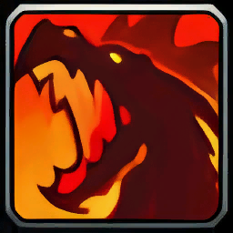
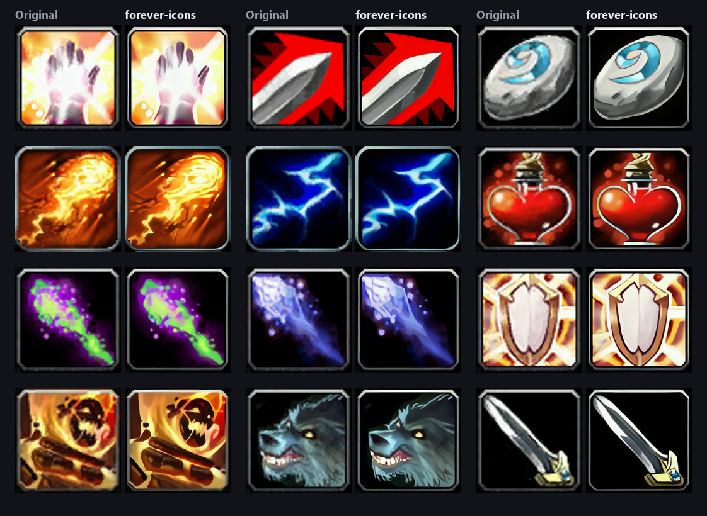
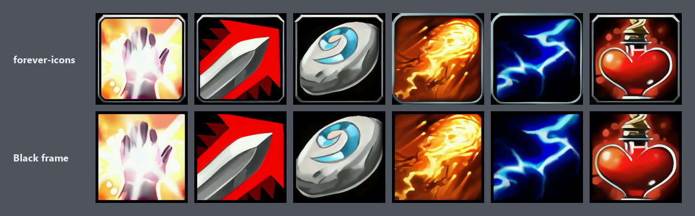

<h1> forever-icons</h1>

A fan-made project that upscales every icon in WoW Forever from 64×64 to 256×256.

[Download the icon pack](../../releases/latest) · [How to install it](INSTALL.md)



Originals are shown stretched, the way the game draws a 64 px icon at a larger size.

## Black-frame version

A second pack swaps the game's grey bevel for a thin black frame. The bevel is cropped off, not framed over, and
round or shaped icons are left as they are. Download `forever-icons-black-frame` from the same release.



If you use a UI addon that skins action buttons (ElvUI, for example), it already trims the icon edges and adds its own
border, so the main pack is the better fit.

## Credits and rights

All icons are the work of **Blizzard Entertainment**. Every icon in this pack is an upscaled copy of Blizzard's
original art, and all credit for it belongs to Blizzard's artists.

I claim no rights to the icons. This is an unofficial, non-commercial fan project, not affiliated with or endorsed by
Blizzard Entertainment. World of Warcraft, Warcraft and Blizzard Entertainment are trademarks or registered trademarks
of Blizzard Entertainment, Inc. If Blizzard asks for the pack to be taken down, it will be.

The code in this repository is open source under the [MIT License](LICENSE). The license covers the scripts only, not
the icons.

Also thanks to:

- [wowdev/wow-listfile](https://github.com/wowdev/wow-listfile) for the community file names
- Kim2091 for 4x-UltraSharp, Nmkd for 4x NMKD-Siax and Mutin Choler for 1x BCGone Smooth, via
  [OpenModelDB](https://openmodeldb.info)
- Microsoft's [DirectXTex](https://github.com/microsoft/DirectXTex) (texconv) for DXT compression
- [spandrel](https://github.com/chaiNNer-org/spandrel) and [PyTorch](https://pytorch.org)

## How the icons are made

| Step | Script | What it does |
|---|---|---|
| 1 | `tools/extract.py` | Reads the icons straight from a local game install (`tools/casc.py`) and names them with the community listfile. |
| 2 | `tools/upscale.py` | A 1× model removes the DXT compression blocks. Two 4× models upscale each icon, each result is shrunk back and compared with the original (alpha-weighted SSIM), and the closer one wins. Alpha is upscaled separately so edges stay clean. |
| 3 | `tools/encode.py` | Makes sharp mipmaps (Lanczos in linear light, premultiplied alpha). Uses DXT1 for opaque icons and DXT5 only where there's real transparency, and writes BLP2 files the game loads. `--frame` crops off the bevel and draws a solid frame instead. |
| 4 | `tools/install.py` | Copies the icons into a game folder and records what it added. `--uninstall` removes exactly those files. |
| 5 | `tools/pack.py` | Zips the icons with `INSTALL.md` for a release. |
| 6 | `tools/showcase.py` | Renders the images in `docs/`. |

`tools/preview.py NAME ...` renders a side-by-side sheet: original, bicubic, both models and the final pick.

Icons that are already 256 px or larger are left alone. Encrypted icons for unreleased content are skipped.

## Building it yourself

You need an NVIDIA GPU, Python 3.13 and a local WoW Forever install.

```
python -m venv .venv
.venv\Scripts\python -m pip install spandrel numpy pillow safetensors
.venv\Scripts\python -m pip install --force-reinstall --no-deps torch torchvision --index-url https://download.pytorch.org/whl/cu128
```

Then download the community listfile to `work/community-listfile.csv`, `texconv.exe` to `bin/`, and the three models
to `models/`, converting each to `.safetensors` with `torch.load(..., weights_only=True)`.

```
python -I tools/extract.py --wow "C:\Program Files (x86)\World of Warcraft" --product wowf
.venv\Scripts\python -I tools/upscale.py --min-ssim 0.80
.venv\Scripts\python -I tools/encode.py
python -I tools/install.py --game "C:\Program Files (x86)\World of Warcraft\_forever_"
python -I tools/pack.py
```

A full run takes about 10 minutes on an RTX 5090 and writes about 2 GB of icons.

### Your own frame

The frame is applied when encoding, so you can make your own without upscaling again. Sizes are in pixels of a
256 px icon:

| Option | Default | What it does |
|---|---|---|
| `--frame` | `0` (off) | Frame width. The black-frame pack uses `8`. |
| `--crop` | `20` | How much is cut off each side first. Below about 20 the grey shows in the corners. |
| `--frame-color` | `000000` | Frame color as hex. |

```
.venv\Scripts\python -I tools/encode.py --frame 8 --out out-frame8
python -I tools/install.py --src out-frame8\Interface\Icons --game "C:\Program Files (x86)\World of Warcraft\_forever_"
python -I tools/pack.py --src out-frame8 --name black-frame
```
